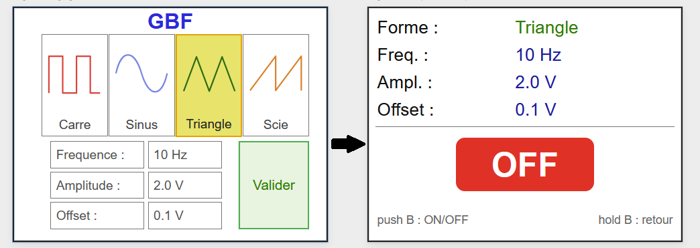
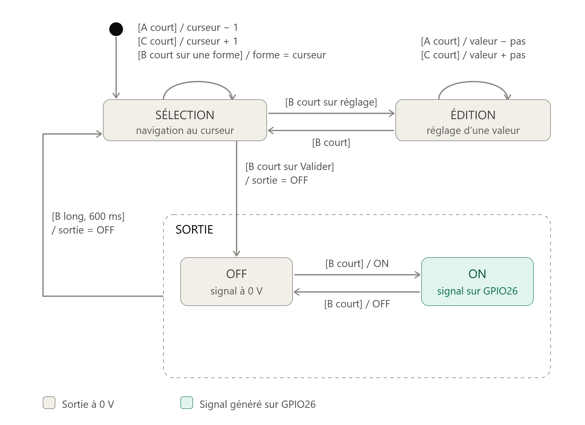
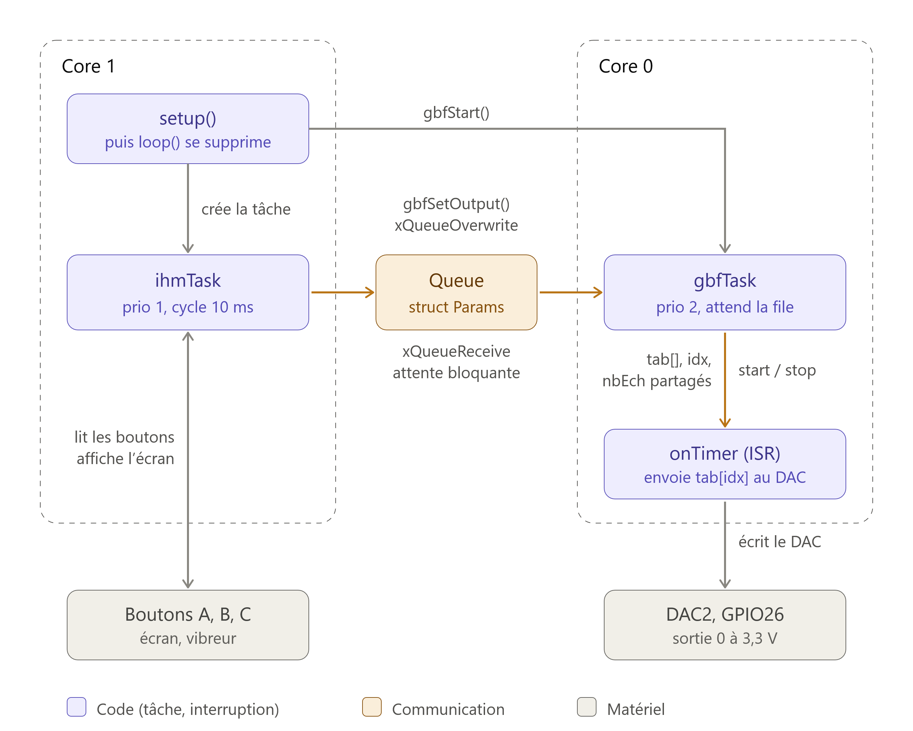

Maquette IHM : 

Diagramme d'état : 

Diagramme des tâches : 

Explications du code : 

main.cpp :

setup() prépare tout : cfg.internal_spk = false libère GPIO25/26 du haut-parleur pour pouvoir utiliser le DAC, setHoldThresh(600) fixe l’appui long sur B à 600 ms, puis il lance la tâche GBF (core 0) et la tâche IHM (core 1). loop() se supprime car tout se passe dans les tâches. Tu inclus directement les .cpp (#include "../lib/ihm.cpp") : ça marche, mais l’usage habituel est de ne compiler que les .cpp et d’inclure les .h.

ihm.cpp : l’interface

Configuration : tout en haut (polices, couleurs, positions), donc facile à ajuster.
État : une variable mode (SELECTION, EDITION ou SORTIE) et les réglages choisis (chosenWave, freq, amp, offs, outputOn).
Dessin : drawWave, drawBar et drawValider dessinent chaque élément, drawItem choisit le bon. moveHighlight ne redessine que l’ancien et le nouvel élément sélectionné, ce qui évite le scintillement.
Logique : ihmUpdate() est la machine à états du diagramme précédent. Selon le mode, elle traduit les appuis A, B et C en actions (déplacer le curseur, modifier une valeur, basculer ON/OFF). freqPas adapte le pas de fréquence (1, 10 ou 100 Hz).
Lien avec le GBF : appliquerSortie() appelle gbfSetOutput(), c’est le seul point de contact.

gbf.cpp : le signal

Le principe est un tableau tab[] contenant une période du signal (100 à 1000 échantillons de 8 bits) et un timer qui déclenche une interruption à la cadence « nombre d’échantillons × fréquence ». À chaque interruption, onTimer envoie le prochain échantillon au DAC2, par écriture directe dans le registre, sans aucun calcul.

Nombre d’échantillons : n = FS_MAX / freq, limité entre 100 et 1000. À 1,5 kHz on a donc 100 points par période, et à 150 Hz ou moins 1000 points.
Remplissage : forme() donne la forme normalisée (0 à 1), puis v = offset + amplitude × forme, écrêté entre 0 et 3,3 V et converti en code 0 à 255. L’amplitude est donc crête à crête et l’offset est le niveau bas.
Timer : à 40 MHz, la période est 40 000 000 / (n × f) ticks. Le code gère les deux versions d’Arduino-ESP32 (2.x et 3.x).
Communication : gbfSetOutput() dépose les paramètres dans une file d’une place. gbfTask les reçoit, arrête le timer, remplit le tableau, puis relance le timer (ou met la sortie à 0 V si OFF).

resultats : 

